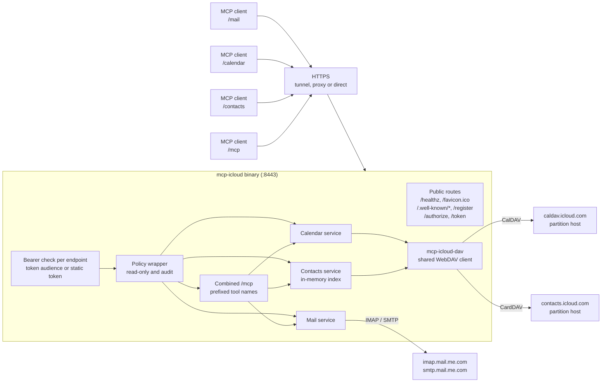
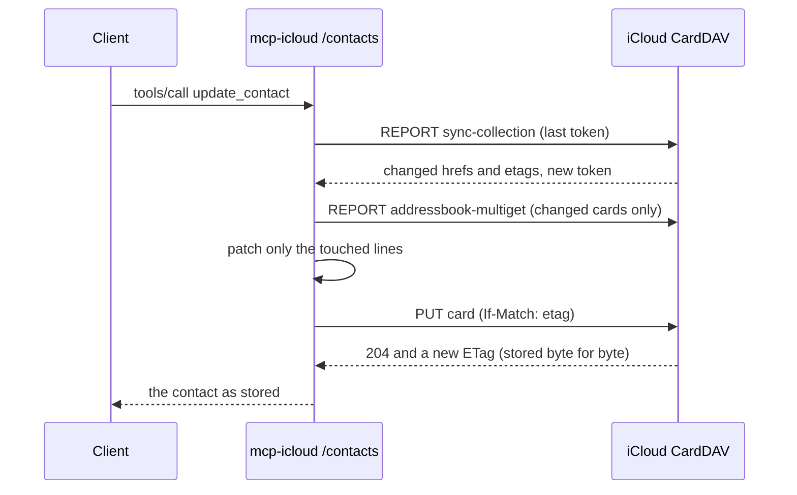

# Architecture

## Request flow

## Crates

| Crate | Role |
|---|---|
| `mcp-server-core` | Configuration reading, the OAuth authorization server, bearer guards, TLS, logging, metrics, the read-only and audit wrapper, and the `Service` trait every service implements |
| `mcp-icloud-dav` | The shared WebDAV client (scoped credentials, redirects, retries), multistatus parsing, home discovery, and the lossless content-line layer used for iCalendar and vCard |
| `mcp-icloud-mail` | The mail service: IMAP client and pool, message parsing, draft building, SMTP sending |
| `mcp-icloud-calendar` | The calendar service: discovery, recurrence expansion, event editing, invitations, time zones |
| `mcp-icloud-contacts` | The contacts service: address book discovery, the synced in-memory index, vCard reading and lossless patching, search, dates and duplicates |
| `mcp-icloud` | The binary: selects services, mounts each at `/<name>` and the combined `/mcp`, and runs the server |

The services do not depend on each other. Anything that combines them lives in the server core or the binary.

## A contact edit, end to end

## Design choices

- **No database.** iCloud is the only store. Caches (message bodies, the calendar list, the contacts index) live in memory and are rebuilt after a restart.
- **Lossless edits.** Calendar and contact edits rewrite only the properties they change and keep every other line, including Apple's own folding, byte for byte.
- **Conditional writes.** Updates send `If-Match` so a change made elsewhere is never overwritten silently. CardDAV deletes are the exception, because iCloud ignores `If-Match` on them; see [Contacts](services/contacts.md#icloud-notes).
- **Safe defaults.** Sending mail and changing invitations need explicit switches, and any service can be made read-only.
