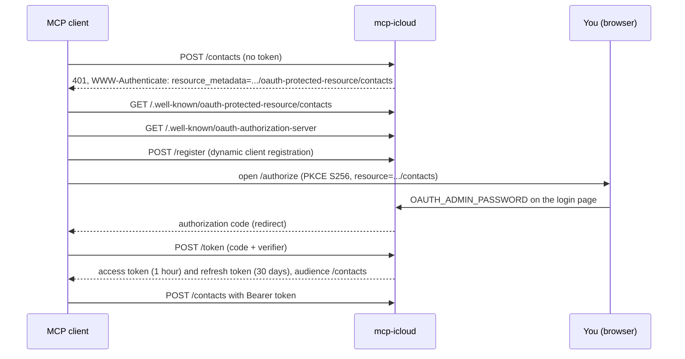

# Security

mcp-icloud holds an app-specific password with access to your mail, calendars and contacts, and is reachable from the internet. This page explains how access is controlled and what the server records.

## Sign-in with OAuth

The server is its own OAuth 2.1 authorization server, built for MCP clients such as claude.ai:



- Each endpoint (`/mail`, `/calendar`, `/contacts`, `/mcp`) is its own OAuth protected resource (RFC 9728) with metadata at `/.well-known/oauth-protected-resource/<endpoint>`.
- Tokens are bound to the endpoint they were issued for (RFC 8707): a token for `/mail` is rejected on `/calendar`.
- One login page and one `OAUTH_ADMIN_PASSWORD` cover every endpoint. The login page names the service being connected.
- Access tokens last 1 hour, refresh tokens 30 days. There is no per-client revocation: rotate `OAUTH_SIGNING_KEY` to sign every client out.

## The static token

`MCP_AUTH_TOKEN` is a single-owner shortcut for clients that can send a header. It is accepted on every endpoint, so treat it like the admin password. Leave it unset if you only use claude.ai.

## Login rate limits

- At most 5 failed logins per minute per client address, and 30 failures per minute in total.
- Trade-off: someone who keeps failing can lock you out of the login page for up to a minute; tokens already issued keep working.
- The client address is the TCP peer. Behind a reverse proxy, set `TRUSTED_PROXIES` to the proxy addresses so the right-most untrusted `X-Forwarded-For` entry is used; otherwise every request shares the proxy address and the per-client limit is effectively global.

## Read-only services

`ICLOUD_READ_ONLY` makes services read-only on this server, for example `ICLOUD_READ_ONLY=mail,contacts` keeps calendar writable, and `all` covers every service.

- Clients see only the tools marked read-only.
- Prompts stay listed; a prompt step that needs a hidden tool tells the model to say so and skip it.
- Any other tool call returns `read_only: the <service> service is read-only on this server`.
- It applies on the service's own endpoint and under `/mcp`.

Combined with the defaults (`ICLOUD_ALLOW_SEND=false`, `ICLOUD_ALLOW_INVITES=false`), this lets you start with an assistant that can only look, and allow changes service by service.

## Audit log

Every call of a tool that is not read-only, including refused ones, produces one audit line:

```json
{"ts": "2026-10-18T10:00:00Z", "service": "contacts", "endpoint": "/contacts", "tool": "delete_contact", "outcome": "ok", "error_kind": null, "caller": "oauth:<client_id>", "elapsed_ms": 120}
```

- `outcome` is `ok`, `error` or `refused` (a read-only service); `error_kind` is the tool error kind such as `conflict` (`read_only` for a refusal, `protocol` for a malformed call), or `null` on success.
- `caller` is `oauth:<client_id>`, `oauth` or `static` (the `MCP_AUTH_TOKEN`).
- Arguments, ids and results are never recorded.
- Lines go to the `audit` log target, which stays on at `info` whatever `LOG_LEVEL` says, and are appended to `AUDIT_LOG_PATH` when it is set (the file is created with mode 0600).
- If the file cannot be written, the server logs a warning at most once a minute and the tool call still succeeds.
- In Docker, mount a volume for the file, for example `./audit:/audit` with `AUDIT_LOG_PATH=/audit/audit.jsonl`, so it survives container restarts.

## What is never logged

- Passwords, tokens, the `Authorization` header and IMAP protocol lines.
- Message, event and contact content: bodies, names, numbers, addresses and notes. Contacts tools log contact ids only.

The only exception is `DEBUG_UNSAFE_LOG_CONTENT=true`, which writes content into the logs for debugging and prints a warning at startup. Credentials are never logged, even then.

## Talking to Apple

- Every connection to Apple uses TLS with certificate verification.
- Calendar and contacts requests send your credentials only to `https` hosts under `icloud.com` (or the exact `CALDAV_URL` or `CARDDAV_URL` host when overridden); redirects elsewhere are refused.
- Revoking the app-specific password at [account.apple.com](https://account.apple.com) cuts the server off immediately.

## The container

The image is `FROM scratch`: the static binary and CA certificates only, running as UID 65532.
